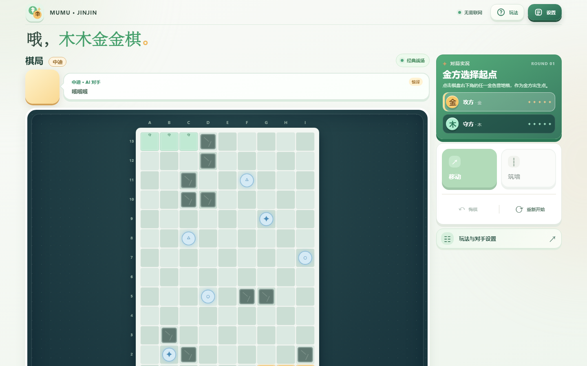

<div align="center">

# 哦，木木金金棋

### 用移动抢占先机，用筑墙改写对手的路线。

**原创策略棋 · 本地双人 / 人机对战 · 9 × 13 棋盘**

[](https://ndshuge.github.io/oh-mumujinjin/)
[](https://ndshuge.github.io/oh-mumujinjin/)
[](docs/AI_TRAINING.md)

**[在线开局](https://ndshuge.github.io/oh-mumujinjin/)** · [地图与 AI](docs/ROADMAP.md) · [开发实验](docs/AI_TRAINING.md)

</div>



<sub>真实在线游戏页面截图；棋盘会随地图、回合和对手设置变化。</sub>

## 30 秒认识玩法

木方与金方轮流移动棋子或放置墙体，尝试率先抵达对岸。墙可以阻碍对手，**但必须保留合法路径**。传送门与进阶地形让选路更有变化。

| 操作 | 策略 |
| --- | --- |
| **移动** | 选择更快、更稳的抵达路径 |
| **筑墙** | 改变对方路线，避免封死合法通路 |
| **传送门** | 通过地图特殊位置寻找捷径 |
| **地图工坊** | 编辑障碍、验证路径、保存与分享地图 |
| **AI 对手** | 选择不同级别的浏览器本地规则 AI，尝试高难度对抗 |

**怎么开始？** [点击进入游戏](https://ndshuge.github.io/oh-mumujinjin/)，桌面端通过侧边设置切换对手与规则；手机端使用右上角设置入口。切换部分模式将重开对局。

## 已实现的功能

- 本地双人、单机人机；常规入门、策略、挑战档位。
- 9 × 13 棋盘、有限墙体、传送门、胜负判断、悔棋。
- 进阶地图实验：冰面惯性、加速带，以及考虑特殊地形的路径合法性。
- 地图工坊 M2：编辑、合法性校验、浏览器本地保存、JSON/链接导入与分享、试玩。
- AI 局面反馈对话；可选择安静模式。
- 面向手机的单屏棋盘与底部操作区设计，仍需在各设备上持续回归验证。

## 在线 AI 与研究 AI 的边界

| 部分 | 状态 | 记录 |
| --- | --- | --- |
| **线上规则 AI** | 可在网页体验 | [线上版本说明](docs/ZHONGDI_ONLINE_RELEASE_20261015.md) |
| **高难度对抗搜索** | 实验中，不保证必胜 | [思考时间与搜索](docs/HELL_AI_THINK_TIME.md) |
| **自对弈 / PUCT / 策略价值模型** | 离线实验，与已发布版本分开 | [训练报告](docs/AI_TRAINING.md) |
| **演化联赛** | 比赛评估候选算法 | [联赛记录](docs/AI_EVOLUTION_LEAGUE.md) |

历史训练包括 10,000 局自对弈、314,181 步独立重放。**训练量不代表实战棋力提高**；此前神经网络完全替代规则启发式的对照失败，不能将其宣传为已经上线的最强 AI。

## 技术栈与验证

HTML / CSS / JavaScript；无需登录、后端游戏服务器或独立云模型 API，规则与常规对局 AI 在浏览器本地运行。

仓库中现有的回归测试脚本：

```bash
node portal-regression.cjs
node ice-regression.cjs
node ai-regression.cjs
node random-map-regression.cjs
node workshop-regression.cjs
```

本次只进行文档和展示整理，不以文档更新替代完整功能测试。

## 项目档案

[开发路线与验收](docs/ROADMAP.md) · [S0–S3 报告](docs/S0_S3_ACCEPTANCE.md) · [AI 训练](docs/AI_TRAINING.md) · [AI 演化联赛](docs/AI_EVOLUTION_LEAGUE.md)

## 授权和反馈

公开体验不等于全部源码、模型或第三方素材都开放再分发或商用；实际使用请确认相关授权。提交问题请说明设备、浏览器、复现步骤，并避免附带个人数据。

<div align="center">

**[开始对弈 →](https://ndshuge.github.io/oh-mumujinjin/)**

<sub>SHUGE LAB · 2026</sub>

</div>
